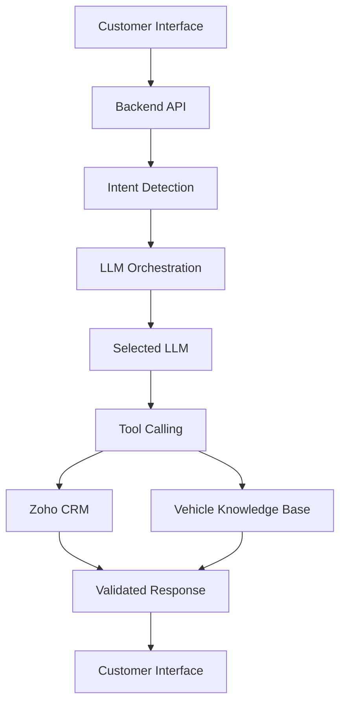

# Automotive AI Assistant

An open-source automotive AI assistant designed to connect conversational AI with vehicle discovery, test-drive scheduling, booking assistance, customer support, and Zoho CRM integration.

Built around **Agentic AI, Multi-LLM Orchestration, and Enterprise API Integration**.

> **Project Status:** In Development

## Overview

Automotive AI Assistant aims to transform traditional automotive chatbots into intelligent assistants that can understand customer intent, maintain conversational context, retrieve business information, and execute authorized actions through backend integrations.

The project focuses on four stages of the automotive customer lifecycle:

- **New Lead:** Vehicle inquiries, specifications, pricing, and test-drive requests.
- **Ongoing Pipeline:** Lead follow-ups, quotations, and test-drive status.
- **Booked Vehicle:** Booking information, delivery updates, and payment-status inquiries.
- **Post-Purchase & Service:** Service requests, maintenance inquiries, and support tickets.

## Features

- Conversational AI for automotive customer queries
- Multi-LLM orchestration architecture
- Vehicle discovery and specification assistance
- Test-drive scheduling workflows
- Booking and delivery-status assistance
- Lead and sales-pipeline management
- Post-purchase service requests
- Zoho CRM integration
- Backend API and tool calling
- Context-aware conversational workflows
- Extensible architecture for additional AI models and integrations

> Feature availability depends on the current implementation and configuration.

## Architecture



## Technology Stack

Update this section to reflect your actual implementation.

- **Frontend:** React.js / Next.js
- **Styling:** CSS / Tailwind CSS
- **Backend:** Node.js / Express.js, if applicable
- **AI:** Configured LLM providers
- **CRM:** Zoho CRM REST API
- **Integration:** REST APIs and tool calling
- **Version Control:** Git and GitHub

## Project Structure

```text
automotive-ai-assistant/
├── frontend/
├── backend/
├── docs/
│   └── architecture.md
├── screenshots/
├── .env.example
├── .gitignore
├── LICENSE
├── CONTRIBUTING.md
├── SECURITY.md
└── README.md
```

Adapt this structure to match your actual repository.

## Getting Started

### Prerequisites

- Git
- Node.js and npm, if required by the project
- API credentials for your configured LLM provider
- Zoho CRM developer credentials, if CRM integration is enabled

### 1. Clone the Repository

```bash
git clone https://github.com/YOUR_USERNAME/automotive-ai-assistant.git
cd automotive-ai-assistant
```

Replace `YOUR_USERNAME` with your GitHub username.

### 2. Install Dependencies

If the frontend and backend have separate `package.json` files, install their dependencies independently.

**Frontend**

```bash
cd frontend
npm install
```

**Backend**

Open another terminal:

```bash
cd backend
npm install
```

### 3. Configure Environment Variables

Create local `.env` files using the environment variables required by your application.

Example placeholders:

```env
NODE_ENV=development
PORT=8000

LLM_PROVIDER=
LLM_API_KEY=

ZOHO_CLIENT_ID=
ZOHO_CLIENT_SECRET=
ZOHO_REFRESH_TOKEN=
ZOHO_REDIRECT_URI=
ZOHO_API_DOMAIN=
```

These are illustrative names. Use the exact variable names expected by your code.

**Never commit API keys, OAuth tokens, passwords, or production credentials.**

### 4. Run the Application

Start the frontend using the development script defined in its `package.json`.

```bash
npm run dev
```

Start the backend separately using its configured development command.

Open the frontend at the local URL displayed in your terminal, for example:

```text
http://localhost:3000
```

Ensure the frontend API URL matches your backend configuration.

## Example Use Cases

### Vehicle Discovery

- Explore vehicle specifications and variants.
- Compare vehicle models.
- Ask questions about vehicle features.

### Sales and Test Drives

- Request a test drive.
- Provide a preferred date and dealership.
- Check test-drive or quotation information.

### Booking Assistance

- Retrieve available booking information.
- Ask about delivery status.
- Check supported payment-related information.

### Post-Purchase Support

- Submit a service request.
- Ask about maintenance.
- Check an existing support ticket.

Actual functionality depends on implemented workflows, available data, and permissions.

## Security and Privacy

- Store credentials in environment variables or a secrets manager.
- Use secure OAuth authentication for CRM access.
- Validate inputs and authorize every business action.
- Apply least-privilege access permissions.
- Protect customer information and redact sensitive logs.
- Validate AI tool calls and model-generated outputs.
- Implement rate limiting, audit logging, and error handling.
- Require confirmation for consequential actions where appropriate.

## Roadmap

- [ ] Improve responsive frontend design.
- [ ] Integrate and test supported LLM providers.
- [ ] Implement intent detection and orchestration.
- [ ] Complete Zoho CRM workflows.
- [ ] Implement test-drive scheduling.
- [ ] Add booking and service workflows.
- [ ] Add automated tests.
- [ ] Improve logging, monitoring, and error recovery.
- [ ] Document deployment and production configuration.

## Contributing

Contributions are welcome!

1. Fork the repository.
2. Create a feature branch.
3. Implement your changes.
4. Run relevant tests.
5. Submit a pull request describing your changes.

For major changes, open an issue before starting implementation.

## License

This project is intended to use the [MIT License](https://opensource.org/license/mit).

Add the complete MIT License text in a `LICENSE` file before distributing the project under this license. Ensure that third-party code and assets permit your intended distribution.

## Disclaimer

This is an independent open-source project and is not affiliated with or endorsed by Mahindra. All trademarks belong to their respective owners.

Vehicle specifications, pricing, availability, and booking information should be verified against authoritative sources.

## Acknowledgements

Thanks to the open-source communities working on AI engineering, LLM orchestration, web development, and CRM integrations.

If you find this project useful, consider starring the repository, reporting issues, or contributing improvements.
